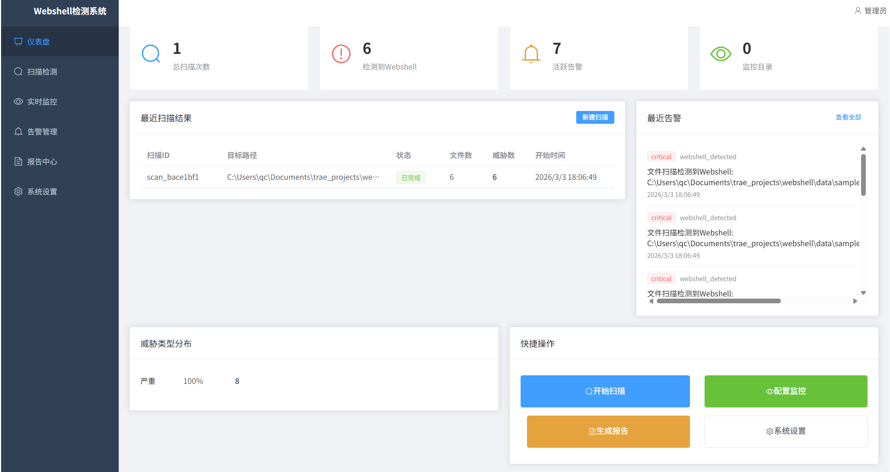
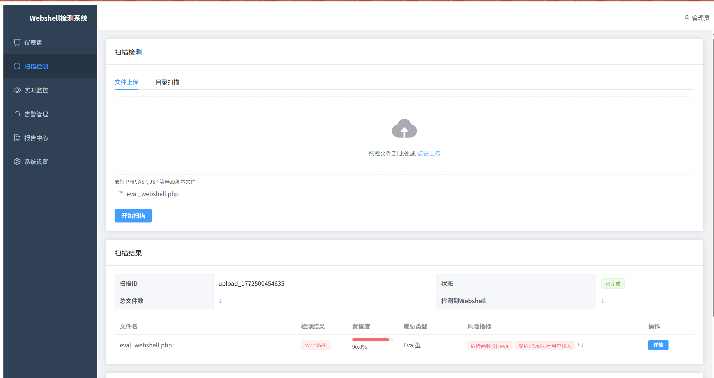
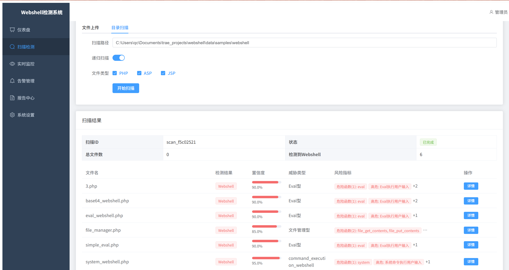
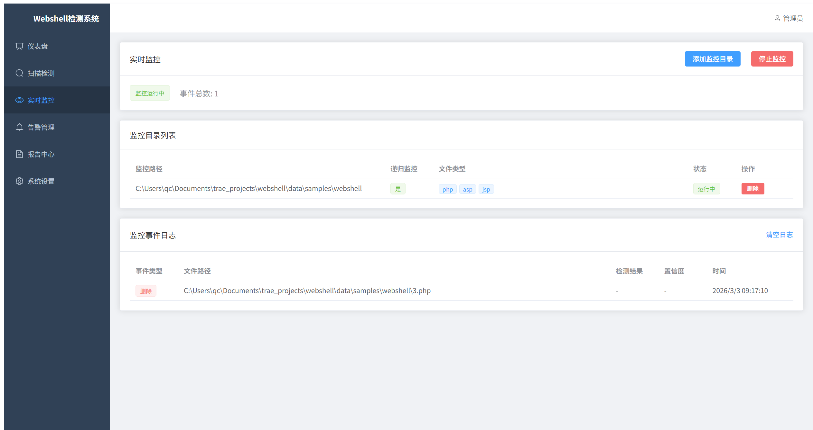
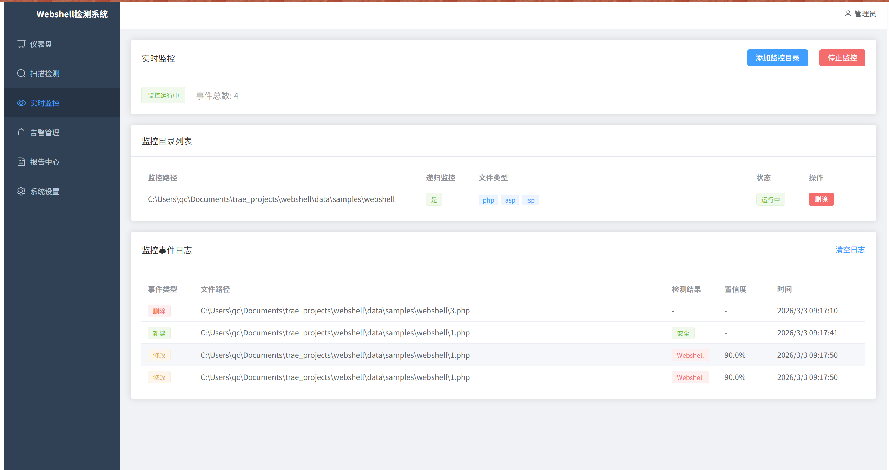
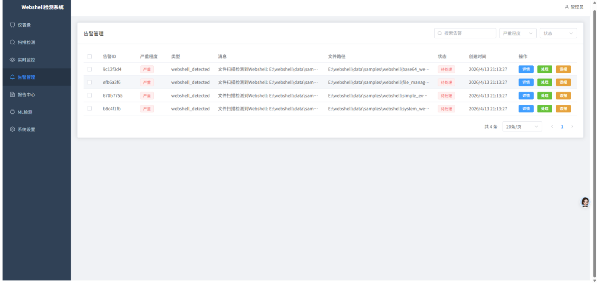

# WebShell 检测系统
# 获取源码：https://mbd.pub/o/bread/YZaVmJ1ubQ==

> 面向中小企业的 WebShell 语义分析检测系统，融合规则匹配与机器学习双重检测引擎，提供文件扫描、实时监控、告警管理与报告生成等一站式安全能力。

## 系统架构

```
┌─────────────────────────────────────────────────────┐
│                    前端 (Vue 3)                       │
│  仪表盘 · 扫描检测 · 实时监控 · 告警管理 · 报告中心     │
└──────────────────────┬──────────────────────────────┘
                       │ HTTP / REST API
┌──────────────────────▼──────────────────────────────┐
│                 后端 (FastAPI + Python)               │
│  ┌──────────┐ ┌──────────┐ ┌──────────┐ ┌────────┐ │
│  │ 扫描引擎  │ │ 监控引擎  │ │ 告警服务  │ │ 报告服务│ │
│  └────┬─────┘ └────┬─────┘ ────┬─────┘ └───┬────┘ │
│  ────▼────────────▼────────────▼────────────▼────┐ │
│  │              核心检测引擎                        │ │
│  │  规则匹配 · 语义分析 · 特征提取 · ML 模型推理    │ │
│  └────────────────────┬───────────────────────────┘ │
│                       │                              │
│  ┌────────────────────▼───────────────────────────┐ │
│  │           SQLite 数据库 (SQLAlchemy)            │ │
│  └────────────────────────────────────────────────┘ │
└─────────────────────────────────────────────────────
```

## 功能特性

### 扫描检测
- **文件上传扫描**：拖拽上传 PHP / ASP / JSP 脚本文件，一键检测
- **目录批量扫描**：指定目录递归扫描，支持多文件类型过滤
- **双引擎检测**：规则匹配 + 机器学习模型协同判定，输出置信度与威胁类型
- **风险指标展示**：标注危险函数、高危行为等具体指标

### 实时监控
- **目录监控**：基于 `watchdog` 的文件系统事件监听
- **实时告警**：文件新增 / 修改 / 删除时即时触发检测
- **事件日志**：完整记录监控事件链，支持日志清理

### 告警管理
- 告警列表分页浏览，按严重程度与状态筛选
- 告警详情查看、处理、忽略操作
- 告警与扫描结果、文件路径关联追溯

### 报告中心
- 基于扫描结果自动生成 PDF 检测报告
- 报告包含威胁统计、文件清单、处置建议

### 仪表盘
- 总扫描次数、检测到 WebShell 数、活跃告警、监控目录数一览
- 最近扫描结果与告警动态
- 威胁类型分布可视化
- 快捷操作入口

### ML 检测
- 基于 XGBoost / LightGBM 的机器学习分类模型
- 多维度特征提取：代码语义、函数调用、编码模式
- 可训练、可替换的模型管理

## 技术栈

| 层级 | 技术 |
|------|------|
| 前端 | Vue 3 + Vite + Element Plus + Pinia + Vue Router + Axios |
| 后端 | Python 3.11 + FastAPI + Uvicorn + SQLAlchemy + Pydantic |
| 检测引擎 | scikit-learn + XGBoost + LightGBM + watchdog |
| 数据库 | SQLite |
| 报告生成 | WeasyPrint (PDF) |
| 可视化 | Matplotlib + Seaborn |

## 项目结构

```
webshell/
├── backend/                  # 后端服务
│   ├── api/                  #   REST API 路由
│   │   ├── routes/           #     路由模块 (scan, monitor, alert, report, ml, auth, settings)
│   │   └── main.py           #     FastAPI 应用入口
│   ├── core/                 #   核心检测引擎
│   │   ├── analyzer/         #     代码分析器
│   │   ├── feature/          #     特征提取
│   │   ├── ml/               #     机器学习模型
│   │   ├── parser/           #     脚本解析器
│   │   ├── scanner/          #     扫描引擎
│   │   ├── semantic/         #     语义分析
│   │   ├── monitor/          #     文件监控
│   │   └── alert/            #     告警引擎
│   ├── models/               #   数据模型 (User, ScanRecord, Alert, Report)
│   ├── services/             #   业务服务层
│   ├── utils/                #   工具类 (数据库、日志、PDF生成、配置)
│   ├── scripts/              #   数据脚本
│   └── config.py             #   全局配置
├── frontend/                 # 前端应用
│   ├── src/
│   │   ├── views/            #     页面组件 (Dashboard, Scan, Monitor, Alerts, Reports, Settings, MLDetection)
│   │   ├── api/              #     API 请求封装
│   │   └── router/           #     路由配置
│   ├── index.html
│   ├── vite.config.js
│   └── package.json
├── data/                     # 数据目录 (数据库、模型、特征、告警)
├── docs/                     # 文档 (架构图等)
├── models/                   # 预训练模型
├── rules/                    # 检测规则
├── samples/                  # 测试样本
├── tests/                    # 测试用例
├── scripts/                  # 辅助脚本 (模型训练)
── logs/                     # 日志目录
── run.py                    # 启动入口
── requirements.txt          # Python 依赖
── er_diagram.puml           # 数据库 ER 图
```

## 快速开始

### 环境要求

- Python 3.11+
- Node.js 16+

### 后端启动

```bash
# 安装依赖
pip install -r requirements.txt

# 开发模式启动（自动重载）
python run.py --mode dev

# 生产模式启动（4 worker）
python run.py --mode prod --host 0.0.0.0 --port 8000
```

后端服务默认运行在 `http://localhost:8000`，API 文档可通过 `http://localhost:8000/docs` 访问。

### 前端启动

```bash
cd frontend

# 安装依赖
npm install

# 开发模式
npm run dev

# 构建生产版本
npm run build
```

前端开发服务器默认运行在 `http://localhost:5173`。

### 模型训练

```bash
python scripts/train_model.py
```

## 系统截图

### 仪表盘



### 文件上传扫描



### 目录扫描



### 实时监控



### 监控事件日志



### 告警管理



## 数据库设计

系统包含 5 个核心实体：

| 实体 | 说明 |
|------|------|
| User | 用户信息、认证凭据、角色权限 |
| ScanRecord | 扫描任务记录（目标路径、状态、文件数、威胁数） |
| ScanResult | 扫描结果明细（文件路径、检测结果、置信度、威胁类型、风险指标） |
| Alert | 告警记录（严重程度、状态、关联文件、处理人与处理时间） |
| Report | 检测报告（PDF 路径、关联扫描任务、生成状态） |

实体关系：User 1:N ScanRecord，ScanRecord 1:N ScanResult，ScanRecord 1:N Report，User 1:N Alert，User 1:N Report

## API 接口

| 模块 | 路径前缀 | 说明 |
|------|---------|------|
| 认证 | `/api/auth` | 用户登录、注册、Token 管理 |
| 扫描 | `/api/scan` | 文件上传扫描、目录扫描、结果查询 |
| 监控 | `/api/monitor` | 目录监控启停、事件日志 |
| 告警 | `/api/alert` | 告警列表、详情、处理、忽略 |
| 报告 | `/api/report` | 报告生成、下载 |
| ML | `/api/ml` | 模型管理、检测 |
| 设置 | `/api/settings` | 系统配置 |

## 检测能力

| 检测维度 | 说明 |
|---------|------|
| 规则匹配 | 基于已知 WebShell 特征模式的正则与关键词匹配 |
| 语义分析 | 解析 PHP/ASP/JSP 代码结构，识别危险函数调用链 |
| 特征提取 | 从代码中提取多维度统计特征（熵值、编码异常、函数分布等） |
| ML 分类 | XGBoost / LightGBM 模型对特征向量进行二分类判定 |
| 置信度输出 | 输出 0~1 置信度分数，区分恶意（>=0.85）与可疑（>=0.6） |

## License

本项目仅供学习与研究使用。
